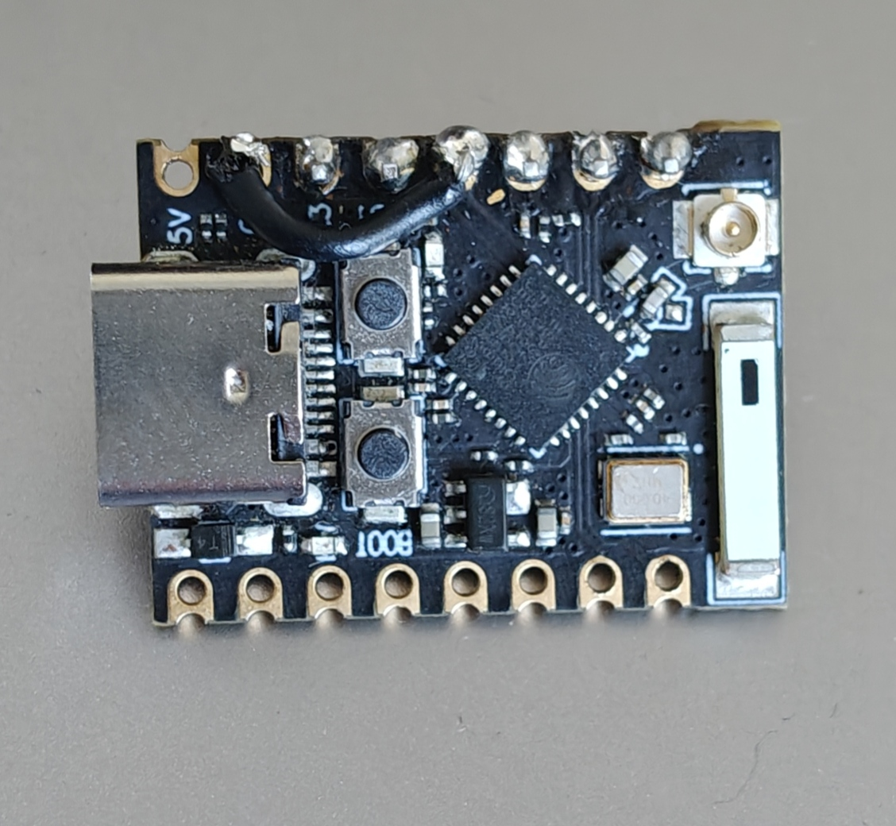
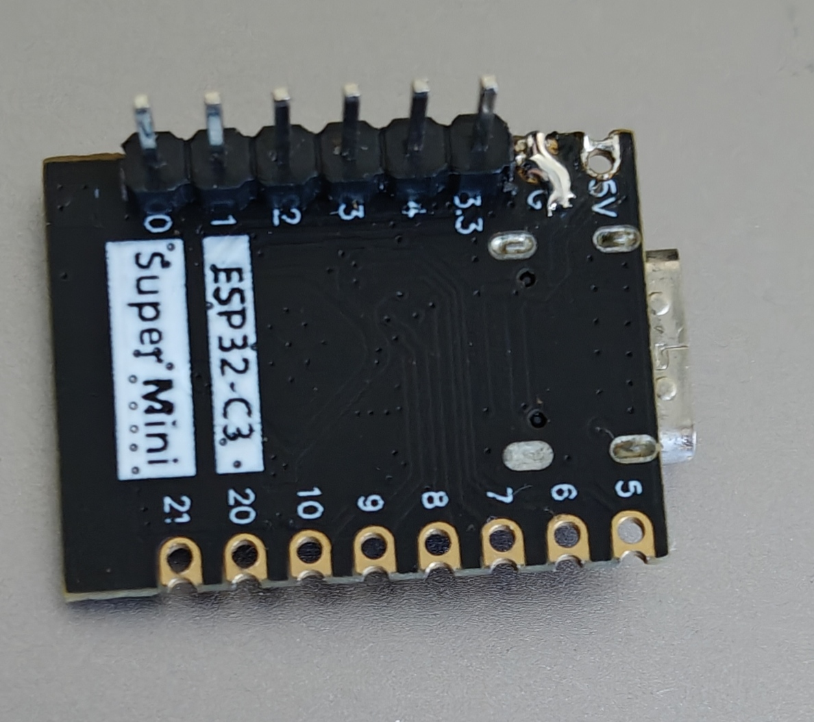

<div align="center">

# Flipper-EvilRelay

### An ISO-DEP (ISO 14443-4) NFC relay for the Flipper Zero

Read a real contactless card on one device, replay its APDUs live to a reader on another. The Flipper Zero does the card emulation.


A port of my [Evil-M5Project](https://github.com/7h30th3r0n3/Evil-M5Project) relay to the Flipper Zero: same relay protocol, same reader side, with the Flipper standing in as the emulator.

**The Flipper presents the card's real ATS, not a phone's random HCE identity, and chains full EMV responses.** Validated end to end against a live EMV terminal and a Proxmark3 (own equipment).

<br>

<a href="https://youtube.com/shorts/lc6wKesM4Y0"></a>

▶ [Watch the PoC demo](https://youtube.com/shorts/lc6wKesM4Y0) (YouTube Short)

</div>

---

> [!WARNING]
> This is a security-research and education project about the **NFC relay attack**, a documented class of attack on contactless protocols. Use it only on cards, readers and payment terminals you own or are explicitly authorised to test. A relay needs the real card physically present and powered at the reader side for every transaction; it does not clone or store the card, and it stops working the moment the real card leaves the field. Relaying someone else's card without consent is fraud and is illegal in most jurisdictions. The author is not responsible for misuse. See [`docs/legal.md`](docs/legal.md).

---

## Why this is different

- **Real card identity.** The Flipper answers `RATS` with the card's own ATS and historical bytes, not Android's random HCE identity. Terminals that fingerprint the card by ATS/SAK see the real card.
- **Full EMV, chained.** Outbound ISO-DEP response chaining is hand-rolled on `iso14443_3a_listener` (the SDK's 4a listener cannot chain), so large `READ RECORD` responses get through.
- **Two reader options.** The real card is read by a phone over Wi-Fi, or by an Evil-Cardputer over ESP-NOW. The phone is the default; the Cardputer is optional.
- **Cheap.** A Flipper plus a roughly 3 USD ESP32-C3, with a phone you already own as the reader.

<br>

| | card identity to the terminal | full EMV (chained) | hardware |
|--|--|--|--|
| **Flipper-EvilRelay** | the real card's ATS/SAK | yes | Flipper + ESP32-C3 |
| NFCGate (phone to phone) | Android's random HCE UID | limited | two phones |
| phone HCE alone | Android's random HCE UID | limited | one phone |
| Proxmark3 relay | real card | yes | two Proxmarks |

---

## Contents

1. [What is this, in plain terms](#1-what-is-this-in-plain-terms)
2. [The short version](#2-the-short-version)
3. [Hardware](#3-hardware)
4. [Wiring](#4-wiring)
5. [How it works](#5-how-it-works)
6. [Build and flash](#6-build-and-flash)
7. [Run it](#7-run-it)
8. [Troubleshooting](#8-troubleshooting)
9. [Repository layout](#9-repository-layout)
10. [Credits, license and support](#10-credits-license-and-support)

---

## 1. What is this, in plain terms

A contactless card and a reader hold a short, fast conversation, and they can only hear each other when they are a couple of centimetres apart. A relay carries that conversation over distance so both sides behave as if they were next to each other.

One device (a phone, or an Evil-Cardputer) sits against the real card and reads every question and answer. Those bytes travel over Wi-Fi, or over ESP-NOW radio, to a small ESP32-C3 board. The ESP32-C3 passes them over a wire into a Flipper Zero. The Flipper is held against the reader or payment terminal and answers as if it were the card.

Nothing is copied or saved. If the real card moves away, the conversation stops on the spot.

The reason the Flipper touches the reader, rather than a second phone, is explained in [section 5.2](#52-why-the-flipper-and-not-a-phone). A phone running Android HCE (Host Card Emulation) cannot fully impersonate a card; a Flipper can.

---

## 2. The short version

```
   REAL CARD                                                     REAL READER / TERMINAL
      |                                                                    ^
      | NFC                                                            NFC |
      v                                                                    |
 +-------------+   Wi-Fi/TCP :5566   +----------+    UART 115200     +-----------+
 |  Phone APK  |-------------------->| ESP32-C3 |------------------->|  Flipper  |
 | (IsoDep rdr)|   or ESP-NOW ch.1   |  bridge  |  GPIO0/1 <-> 13/14 |  ISO-DEP  |
 +-------------+                     +----------+                    +-----------+
   reads the card                     byte pipe                       emulates the card
```

Three parts, all in this repo:

| Part | Folder | Role |
|------|--------|------|
| Flipper FAP `EvilRelay ISO-DEP` | [`flipper-fap/`](flipper-fap/) | Emulates the card to the reader at ISO-DEP layer 4. |
| ESP32-C3 bridge | [`esp32-bridge/`](esp32-bridge/) | Carries relay frames between Wi-Fi/ESP-NOW and the Flipper UART. |
| Android reader APK | [`android-reader/`](android-reader/) | Reads the real card and ships its APDUs over Wi-Fi. An Evil-Cardputer can take this role instead. |

---

## 3. Hardware

| Item | Why | Where |
|------|-----|-------|
| Flipper Zero | The card emulator. Needs a firmware with the `iso14443_3a_listener` NFC stack: Momentum, Unleashed, or a recent official build. | [flipperzero.one](https://flipperzero.one/) |
| ESP32-C3 with external antenna | The transport bridge. Pick a set that includes the antenna. | [AliExpress](https://s.click.aliexpress.com/e/_DD1yibp) |
| Android phone with NFC | The reader. An ESP-NOW Evil-Cardputer can replace it. | |

Any ESP32 works. On a classic ESP32 or an S3 you change two pin defines in the sketch (see [section 5.8](#58-the-esp32-c3-bridge)). The C3 with an external antenna is the recommended default: cheap, 3.3 V native, and the antenna keeps the Wi-Fi link stable at the counter.

> Some of the links above are affiliate links; buying through them supports the project at no extra cost to you.

---

## 4. Wiring

Four pins. Both boards run at 3.3 V, so they connect directly with no level shifter. The pins are chosen so the C3 lines up with the Flipper header and plugs straight on.

```
  Flipper Zero GPIO                         ESP32-C3
  +------------------+                   +---------------------------+
  | pin 13  TX  -----+-------------------+--> GPIO1  (UART_RX_PIN)    |
  | pin 14  RX  <----+-------------------+--- GPIO0  (UART_TX_PIN)    |
  | pin  9  3V3 -----+-------------------+--> 3V3    (power)          |
  | pin 11/18 GND ---+-------------------+--> GND, jumpered to GPIO3  |
  +------------------+                   +---------------------------+
```

| Flipper Zero | ESP32-C3 | Note |
|--------------|----------|------|
| pin 13 (`TX`) | `GPIO1` (`UART_RX_PIN`) | Flipper transmits, C3 receives |
| pin 14 (`RX`) | `GPIO0` (`UART_TX_PIN`) | C3 transmits, Flipper receives |
| pin 9 (`3V3`) | `3V3` | standard power pin, the Flipper powers the C3 |
| pin 11 or 18 (`GND`) | `GND` | the Flipper GND lines up with the C3 `GPIO3` position, so a short jumper ties `GPIO3` to the C3 `GND` and the ground is picked up there |

The board shown here is an ESP32-C3 SuperMini; its top row is `0 1 2 3 4 3.3 G 5V`. A short jumper bridges `G` (GND) to `3` (GPIO3) so the ground sits at that position:

<div align="center">


</div>

**Notes**

- The `G`-to-`GPIO3` jumper is only there so the C3 plugs straight onto the Flipper header; it is a small solder mod on the board. If you are wiring with jumper leads instead, skip it and connect Flipper GND to the C3 `GND` pad directly.
- The ground trick lets all four contacts align on the Flipper header for a direct plug. `GPIO3` carries no signal; it is tied to ground and left unused in the sketch.
- Use insulated wire for the `G`-to-`GPIO3` jumper. It runs over the `3.3` and `GPIO4` pads, and a bare wire or a solder bridge onto `3.3` would short the Flipper's 3V3 rail to ground. Keep both joints clean.
- `GPIO0` and `GPIO1` are C3-safe: not strapping pins (`GPIO2/8/9`), not the native USB (`GPIO18/19`), not the UART0 console (`GPIO20/21`), not the SPI flash.
- On a classic ESP32 use for example `16/17`; on an S3 use any free GPIOs. Edit `UART_RX_PIN` and `UART_TX_PIN` at the top of the sketch.
- Keep both baud rates equal: the sketch `UART_BAUD` and the FAP `RELAY_UART_BAUD` are both `115200`.

Full notes: [`docs/wiring.md`](docs/wiring.md).

---

## 5. How it works

### 5.1 The big picture

A contactless EMV or DESFire transaction is a sequence of APDUs (Application Protocol Data Units). The reader sends a command APDU, the card answers with a response APDU, back and forth, often dozens of times. A relay transports those APDUs unchanged between where the card is and where the reader is.

```
reader <-> [Flipper: emulator] <-UART-> [ESP32: bridge] <-Wi-Fi/ESP-NOW-> [phone/Cardputer: reader] <-> real card
```

The reader side forwards the terminal's command APDUs to the card and ships the card's responses back. It starts nothing of its own. The emulator side, the Flipper, handles the low-level ISO-DEP handshake itself (anticollision, `RATS`, `PPS`, block chaining, ACKs) and relays only the application APDUs. The work is getting the Flipper to act as a protocol-correct ISO-DEP card.

### 5.2 Why the Flipper and not a phone

Android can emulate a card with HCE (Host Card Emulation), so the obvious question is why a Flipper is needed. HCE is limited on purpose:

- Android assigns its own random UID and will not let you set the card's real UID.
- Android does not expose the card's `ATS` or `SAK` to the emulation layer.

A terminal that fingerprints the card by its ATS or SAK rejects an HCE phone, because the phone presents Android's identity rather than the card's. This FAP emulates at the raw ISO 14443-3A layer and builds a valid ATS that carries the real card's historical bytes, so the reader sees the card's identity rather than a phone's.

This addresses identity fingerprinting only. A terminal running EMV RRP (Relay Resistance Protocol) times the responses and will still reject a relay on latency, by design, so RRP-capable terminals are the documented defence against this attack. That is why the Flipper, not a second phone, is the device touching the terminal.

The APK still includes an HCE Emulator mode for phone-to-phone tests, but the real-terminal path is phone-as-reader to Flipper-as-emulator.

### 5.3 ISO-DEP in five minutes

ISO-DEP (ISO 14443-4) is the half-duplex block-transport layer on top of ISO 14443-3A that carries APDUs. The handshake, in order:

1. Anticollision (3A). The reader sends `WUPA/REQA`, the card answers `ATQA`, the reader runs the `SELECT` cascade, the card returns its `UID` and `SAK`. `SAK` bit `0x20` signals ISO-DEP is available.
2. `RATS` (Request for Answer To Select, PCB `0xE0`). The reader announces the largest frame it can receive, its FSD encoded as FSDI, and a channel id (CID).
3. `ATS` (Answer To Select). The card replies with its capabilities: the frame size it can send (FSCI), timing (FWI and SFGI in TB1), and historical bytes.
4. Optional `PPS` (`0xD0...`), protocol and parameter selection, usually echoed.
5. I-blocks carry APDUs. Each block's PCB (Protocol Control Byte) holds a 1-bit block number that toggles, a chaining bit, and optional CID/NAD. R-blocks are ACK/NAK. S-blocks are `DESELECT` or `WTX` (waiting-time extension).

PCB bits this FAP acts on:

| PCB pattern | Meaning |
|-------------|---------|
| `(pcb & 0xE2) == 0x02` | I-block (carries an APDU) |
| bit `0x10` | chaining, more blocks follow |
| bit `0x08` | CID present |
| bit `0x04` | NAD present |
| bit `0x01` | block number |
| `(pcb & 0xC0) == 0x80` | R-block (ACK/NAK) |
| `0xC2` | S(DESELECT) |
| `0xF2` | S(WTX) |
| `0xE0` | RATS |
| `0xDx` | PPS |

### 5.4 What the Flipper FAP does

The Flipper SDK ships an `iso14443_4a_listener` that looks like it should handle all of this, but it only ever sends one unchained I-block per response (`iso14443_4a_listener_send_block`), and it exposes no outbound chaining (only the poller side has `iso14443_4a_poller_send_chain_block`). A card response larger than the reader's FSD then returns `Iso14443_4aErrorProtocol` and the firmware crashes. EMV `READ RECORD` responses routinely exceed that size.

So this FAP drops down to `iso14443_3a_listener` and runs the ISO-DEP layer-4 state machine by hand (`flipper-fap/relay_nfc.c`):

- Answers `RATS` with a crafted ATS (see [5.5](#55-the-ats-and-timing-budget)).
- Answers a `PPS` request with the PPSS byte.
- Reassembles reader-chained command APDUs, then hands the complete APDU to the relay.
- Sends the card's response back as one or several I-blocks with correct outbound chaining (see [5.6](#56-response-chaining)), waiting for the reader's R(ACK) between chunks and toggling the block number.
- Handles `S(DESELECT)` (echo and re-arm for the next tap) and field-off or halt resets.

Two Flipper-specific details are built in. On `iso14443_3a_listener`, RX gives you `PCB + payload` without the CRC and TX (`iso14443_3a_listener_send_standard_frame`) adds the CRC, so the layer-4 code never touches CRCs.

The NFC listener is also started from a worker thread, which needed a larger stack and an off-stack frame buffer to avoid a stack-overflow reboot.

### 5.5 The ATS and timing budget

The relay round trip (reader to Flipper to UART to ESP32 to Wi-Fi to phone to the real card, and all the way back) takes much longer than a local card. Readers tolerate that only up to the Frame Waiting Time (FWT) promised in the ATS.

The FAP builds the ATS to advertise a long FWT. It forces `FWI = 14` in the ATS TB1 byte (`0xE0`), which is an FWT of about 4.9 s. The default ATS is `{0x05, 0x78, 0x80, 0xE0, 0x00}` (TL, T0, TA1, TB1=0xE0, TC1). When a real card's ATS arrives in the IDENT frame, TB1's high nibble is overwritten to `0xE` while the SFGI low nibble is preserved. The card's real historical bytes are kept, so fingerprinting still sees the genuine card.

On the Flipper side the response semaphore budget is `RELAY_RESP_TIMEOUT_MS = 3000`, well under the 4.9 s FWT. If the card response does not return within 3 s the FAP answers `6F00` instead of hanging. The FAP does not emit `S(WTX)`; the long advertised FWT covers the whole round trip, so WTX is not needed for the terminals tested here.

### 5.6 Response chaining

This is how the FAP returns a response that does not fit in a single frame. When the card's response is larger than the reader's FSD (parsed from the RATS FSDI table `{16,24,32,40,48,64,96,128,256}`), the FAP splits it into chunks:

```
chunk_max  = min(reader_FSD - header - 2 (CRC), 250)   // and never below 8
PCB        = 0x02 | block_number | (CID ? 0x08 : 0) | (last_chunk ? 0 : 0x10 chaining)
block_number = (base_bn XOR chunk_index) & 1
```

It sends the first chunk with the chaining bit set, waits for the reader's R(ACK), toggles the block number, sends the next chunk, and repeats until the final chunk goes out with the chaining bit clear, exactly as a real card alternates it. A 157-byte response against an FSD of 128, for example, goes out as two clean chained blocks.

The relayed card response is buffered up to 512 bytes (`RELAY_PAYLOAD_MAX`), which covers normal contactless EMV and DESFire; a single response larger than that is not relayed.

### 5.7 The relay wire protocol

The same small protocol runs over UART and over TCP. ESP-NOW adds a fragmentation header because its MTU is about 250 bytes.

```
UART / TCP :  [0x5A][type][seq][lenHi][lenLo][payload...]           (one frame = one message)
ESP-NOW    :  [0x5A][type][seq][fidx][ftot][plen][payload <=230]    (reassembled by the bridge)
```

| type | name | direction | payload |
|------|------|-----------|---------|
| `1` | IDENT | reader to Flipper | `[uidLen][uid...][atqa0][atqa1][sak][atsLen][ats...]`, the card identity used to build the ATS |
| `2` | REQ | Flipper to reader | an application command APDU from the terminal |
| `3` | RESP | reader to Flipper | the card's response APDU |

It is strictly half-duplex: one APDU in flight at a time, with an 8-bit sequence number. The reader sends IDENT once at tap, then the loop is REQ, talk to the card, RESP.

### 5.8 The ESP32-C3 bridge

`esp32-bridge/EvilRelayESP32.ino` is a stateless byte pipe that does no NFC. It brings up both reader transports at once (`WIFI_AP_STA`, channel 1):

- a SoftAP `EvilRelay` / `evilrelay1234` with a TCP server on port 5566 at `192.168.4.1`, for the phone (change the SSID and password at the top of the sketch);
- ESP-NOW broadcast on channel 1, for an Evil-Cardputer reader.

It reframes relay messages between the air side and the Flipper UART at 115200 (`UART_RX_PIN = GPIO1`, `UART_TX_PIN = GPIO0`). For an outbound REQ it prefers a connected TCP phone, otherwise it broadcasts over ESP-NOW. The ESP-NOW receive callback compiles on both arduino-esp32 2.x and 3.x, guarded by `ESP_ARDUINO_VERSION_MAJOR`. USB serial at 115200 prints the AP IP and link events.

### 5.9 The reader side

Android APK (`android-reader/`), Reader mode: it opens the real card with `IsoDep`, reads the UID, ATQA, SAK and historical bytes, builds the ATS (`[len][0x78][0x80][0xE0][0x00] + historicalBytes`, TB1 = `0xE0` so FWI 14) and sends the IDENT frame to `192.168.4.1:5566`. Then it loops: receive REQ, `IsoDep.transceive` to the card, send RESP.

A "Keep screen on" switch (default on, persisted) holds `FLAG_KEEP_SCREEN_ON` so the phone does not auto-lock mid-transaction and drop NFC. `SAK 0x20` is preserved end to end so the reader keeps treating the target as ISO-DEP.

An Evil-Cardputer plays the same reader role over ESP-NOW (Cap NFC, Relay/Emul, Dual, Relay: Reader (A)), which is why the bridge speaks both transports.

---

## 6. Build and flash

Short version here. Full toolchain and gotchas in [`docs/build.md`](docs/build.md).

### Flipper FAP

No build needed: download `evil_relay.fap` from the [Releases](../../releases) page and drop it on the Flipper (`apps/NFC/`). It is developed against [Momentum](https://momentum-fw.dev/) firmware; on other forks, rebuild from source.

To build it yourself, use [`ufbt`](https://github.com/flipperdevices/flipperzero-ufbt). It is developed against the Momentum (mntm) SDK; other firmware forks may need the matching `ufbt` SDK channel, or small API tweaks, because it calls the firmware's internal NFC-listener APIs.

```bash
pip install --user ufbt        # once
ufbt update                    # pulls the SDK for your firmware channel (e.g. -b dev)
cd flipper-fap
ufbt            # build -> dist/evil_relay.fap
ufbt launch     # build, install and run on a connected Flipper
```

The FAP appears under NFC as `EvilRelay ISO-DEP` (appid `evil_relay`).

### ESP32-C3 bridge

No build needed: download `EvilRelayESP32-esp32c3.bin` from the [Releases](../../releases) page and flash it at offset `0x0` with esptool, or any ESP web flasher:

```bash
esptool.py --chip esp32c3 write_flash 0x0 EvilRelayESP32-esp32c3.bin
```

It targets a generic ESP32-C3 (4 MB flash). To build it yourself, or for another board:

```bash
# one-time setup: install arduino-cli (https://arduino.github.io/arduino-cli), then the ESP32 core
arduino-cli config init
arduino-cli config add board_manager.additional_urls https://espressif.github.io/arduino-esp32/package_esp32_index.json
arduino-cli core update-index
arduino-cli core install esp32:esp32

# ESP32-C3 (SuperMini and most generic C3 boards). Any ESP32 works; change the FQBN and pins.
arduino-cli compile --fqbn esp32:esp32:esp32c3 esp32-bridge
arduino-cli upload  --fqbn esp32:esp32:esp32c3 -p /dev/ttyACM0 esp32-bridge

# alternative, M5Stamp C3:
# arduino-cli compile --fqbn m5stack:esp32:m5stack_stamp_c3 esp32-bridge
```

The port is `/dev/ttyACM0` on Linux, `COMx` on Windows, `/dev/cu.usbmodem*` on macOS; find it with `arduino-cli board list`.

### Android reader

A prebuilt `android-reader/EvilRelay-v1.8.apk` is included (debug-signed; allow install from unknown apps). Copy it to the phone and install it. To build from source, open `android-reader/src/` in Android Studio, or run `./gradlew assembleDebug` there.

---

## 7. Run it

1. Wire the ESP32-C3 to the Flipper ([section 4](#4-wiring)), flash both, power the ESP32.
2. On the Flipper, open NFC, `EvilRelay ISO-DEP`. It shows "Waiting reader (UART)". As soon as the bridge sends a byte it becomes "Reader linked".
3. Reader side:
   - Phone: in Android Settings, join Wi-Fi `EvilRelay` / `evilrelay1234` first (tap "stay connected" on the no-internet prompt, and turn mobile data off, or Android routes the socket over cellular and never reaches `192.168.4.1`). Then open the EvilRelay app in Reader mode (peer IP `192.168.4.1`), hold the phone against the real card. The IDENT frame (UID and ATS) is sent.
   - Evil-Cardputer: Cap NFC, Relay/Emul, Dual, Relay: Reader (A), present the card.
4. Present the Flipper to the reader or terminal. The APDUs relay and the Flipper screen counts them. If you have a Proxmark3, test with it first (`hf 14a info`, `hf emv`): it shows the relayed UID and ATS before you try a real terminal.

---

## 8. Troubleshooting

| Symptom | Likely cause | Fix |
|--------|--------------|-----|
| Flipper stays on "Waiting reader" | No UART bytes | Check TX and RX are crossed (Flipper 13 to C3 GPIO1, Flipper 14 to C3 GPIO0) and the ground is connected |
| Phone joins Wi-Fi but the relay never connects | Android routes the socket over mobile data | Turn mobile data off and stay on the `EvilRelay` Wi-Fi (no internet is normal) |
| Reader sees nothing, no RATS | ATS or SAK wrong, or HCE used against an RRP terminal | Use the Flipper path, not phone HCE ([5.2](#52-why-the-flipper-and-not-a-phone)) |
| Transaction starts then drops | Phone auto-locked, or round trip over FWT | Turn on "Keep screen on" in the app, keep the Wi-Fi link strong (C3 with antenna) |
| C3 serial port vanished after flashing | Some firmwares grab USB | Replug while holding `BOOT` (GPIO9) to force download mode |

---

## 9. Repository layout

```
Flipper-EvilRelay/
├── flipper-fap/            the Flipper FAP (ISO-DEP emulator)
│   ├── application.fam     appid evil_relay, "EvilRelay ISO-DEP", category NFC
│   ├── evil_relay.c        GUI and bring-up (NFC + UART)
│   ├── relay_nfc.c/.h      ISO-DEP layer-4 state machine (RATS/ATS/PPS/I/R/S + chaining)
│   ├── relay_uart.c/.h     UART transport (ISR, stream buffer, worker thread)
│   └── evil_relay.png      FAP icon
├── esp32-bridge/           the transport bridge
│   └── EvilRelayESP32.ino  SoftAP + TCP 5566 and ESP-NOW ch.1 to Flipper UART 115200
├── android-reader/         the reader
│   ├── EvilRelay-v1.8.apk  prebuilt APK
│   └── src/                Android/Kotlin source
├── docs/                   wiring, build, legal
└── images/
```

---

## 10. Credits, license and support

Both this and the [Evil-M5Project](https://github.com/7h30th3r0n3/Evil-M5Project) are mine (7h30th3r0n3). Flipper-EvilRelay ports the Evil-M5Project relay to the Flipper Zero: same relay protocol, same reader side, with the Flipper as the ISO-DEP emulator in place of an Evil device.

Built on the Flipper Zero NFC stack (`iso14443_3a_listener`) and the Momentum SDK. This project is licensed **GPLv3** ([`LICENSE`](LICENSE)): any redistributed version, modified or not, must stay open-source under GPLv3 and keep the copyright and attribution notices. It is the same license as the Flipper firmware it runs on. See [`NOTICE`](NOTICE).

If you want the full toolkit the relay came from, it is [Evil-M5Project](https://github.com/7h30th3r0n3/Evil-M5Project). You can back the work on [Ko-fi](https://ko-fi.com/7h30th3r0n3); the hardware links in [section 3](#3-hardware) are affiliate links.

<br>

> Authorised and lawful use only, see [`docs/legal.md`](docs/legal.md).
